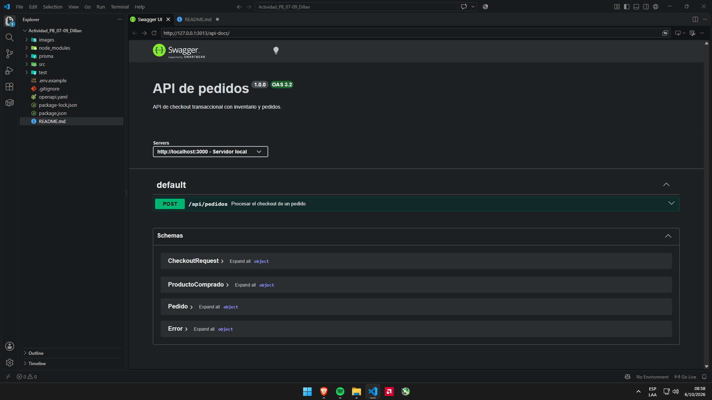
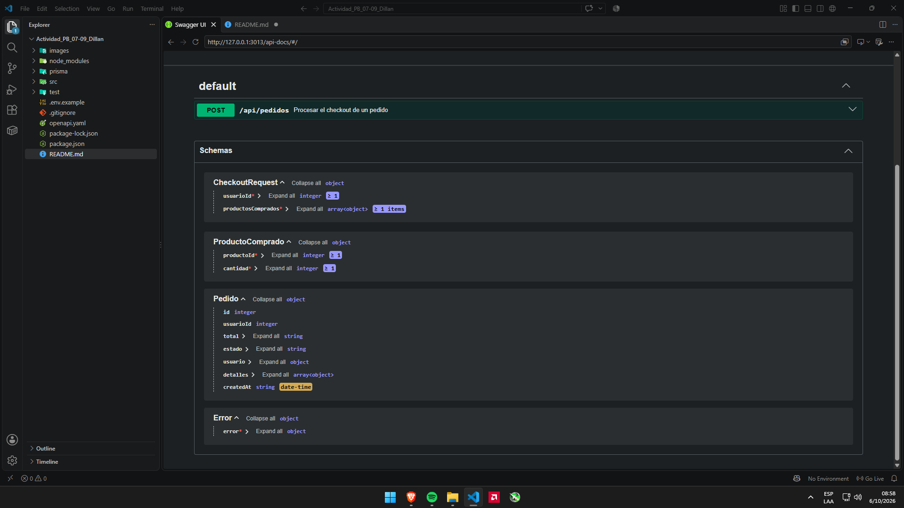

# API de pedidos con Prisma y Swagger

API REST de checkout construida con Express, Prisma ORM y PostgreSQL. El
inventario, el pedido y sus detalles se procesan dentro de una única transacción.

## Requisitos y configuración

- Node.js 18 o posterior
- PostgreSQL en ejecución

```powershell
npm install
Copy-Item .env.example .env
```

Edita `DATABASE_URL` en `.env` con las credenciales y el nombre de tu base
PostgreSQL. Luego genera el cliente y ejecuta las migraciones:

```powershell
npm run prisma:generate
npm run db:migrate -- --name init
npm test
npm start
```

La API escucha en `http://localhost:3000`. La referencia interactiva de Swagger
está disponible en `http://localhost:3000/api-docs`; el contrato OpenAPI original
se sirve en `http://localhost:3000/openapi.yaml`.

## Arquitectura

```text
prisma/schema.prisma          Modelos y relaciones PostgreSQL
src/
  app.js                      Middleware Express, rutas y errores
  controllers/pedidos.js      Validación del contrato HTTP
  repositories/index.js       CRUD Prisma para las entidades
  routes/pedidos.js           POST /api/pedidos
  services/pedidos.js         Checkout y control de stock transaccional
  server.js                   Inicialización del cliente Prisma y servidor
openapi.yaml                  Especificación OpenAPI 3.2.0
test/pedidos.test.js          Pruebas del checkout y rollback
```

## Checkout

`POST /api/pedidos` recibe un `usuarioId` y uno o más elementos en
`productosComprados`, cada uno con `productoId` y `cantidad`. La API consolida
productos repetidos, descuenta stock con una actualización condicional y almacena
precios y totales en centavos para evitar errores de punto flotante. Si el
usuario/producto no existe, falta stock o falla cualquier operación, la
transacción completa se revierte.

Ejemplo:

```json
{
  "usuarioId": 1,
  "productosComprados": [
    { "productoId": 12, "cantidad": 2 },
    { "productoId": 18, "cantidad": 1 }
  ]
}
```

Responde `201 Created` con el pedido y sus detalles. Los errores de validación,
referencias inexistentes y stock insuficiente responden `400`; el exceso del
límite monetario responde `422`.






